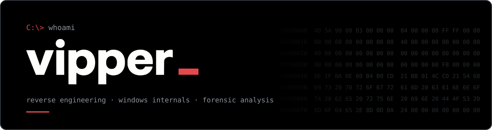

<div align="center">



<a href="https://discord.com/users/711838932207140925"></a>
<a href="https://discord.gg/v8rZRbHhWE"></a>


</div>

---

## About

Focused on **reverse engineering, Windows internals and forensic analysis**, with a strong interest in pentesting.

Most of my work is about understanding what happens beneath the surface of the OS. I apply that to **forensic screensharing in FiveM environments**, building tooling that exposes what cheats, bypasses and malware try to hide.

```cpp
// whoami.cpp
namespace vipper {

    constexpr const char* focus[] = {
        "Reverse Engineering",
        "Windows Internals",
        "Forensic Analysis",
        "Malware & Cheat Analysis",
        "Pentesting",
    };

    constexpr const char* applied_to = "Forensic screensharing in FiveM";

    constexpr const char* languages[] = { "C", "C++", "Python", "C#", "Lua", "Dart", "Java" };
    constexpr const char* tooling[]   = { "IDA", "Ghidra", "x64dbg", "WinDbg", "Sysinternals", "System Informer" };

    constexpr const char* mission =
        "Expose what cheats, bypasses and malware try to hide.";
}
```

## What I work on

- **Malware & cheat analysis**: unpacking (VMProtect, Themida, Enigma), static and dynamic analysis, behavioral triage
- **Windows internals**: kernel drivers, IOCTL, the syscall layer, win32k, the memory subsystem, process and thread internals
- **Reverse engineering**: PE analysis, decompilation, string and config extraction, protocol reversing
- **Forensic tooling**: tools that collect, detect and expose what normally stays hidden
- **Game integrity research**: anti-cheat mechanisms, bypass techniques, DLL injection, kernel-level cheats

## Stack

**Languages**

<p>


</p>

**Reversing & analysis**

<p>


</p>
